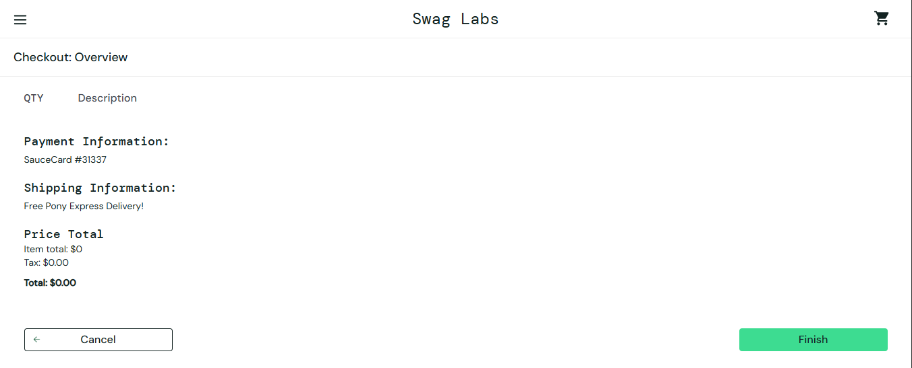
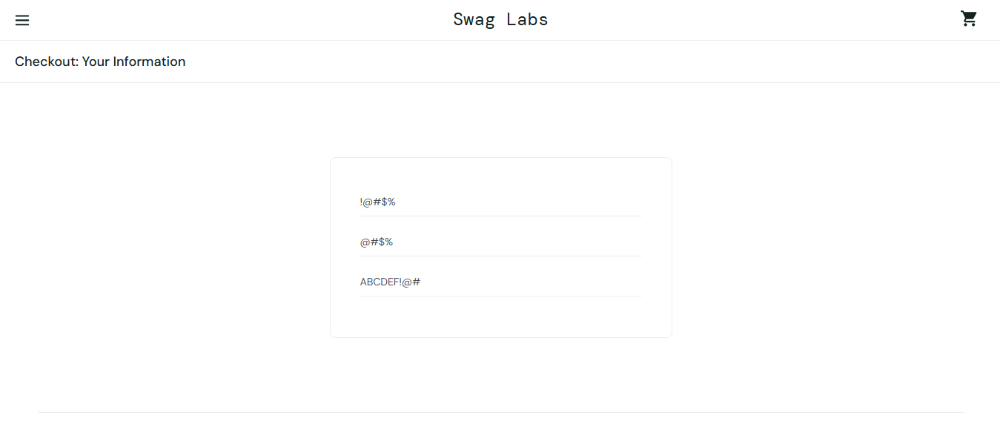
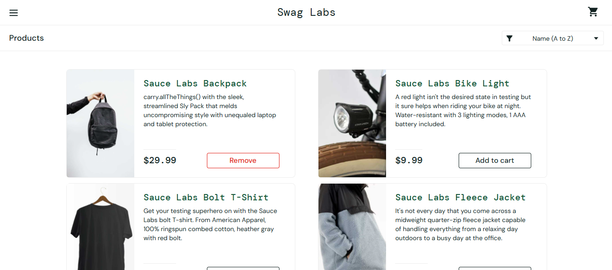

# Relatório de Defeitos (Bug Reports) - Plataforma E-commerce SauceDemo

| Documento | Versão | Responsável | Status | Ferramenta de Rastreio |
| :--- | :--- | :--- | :--- | :--- |
| **BR-001** | 1.0 | QA Team | Concluído | GitHub Issues / Documentação |

---

## 1. Visão Geral & Classificação de Defeitos

Este documento consolida as anomalias e falhas identificadas durante a execução dos roteiros de teste (`TC-001`) e da especificação de Caixa-Preta (`BBD-001`). 

A classificação de cada defeito obedece a dois critérios independentes de engenharia de qualidade:

* **Severidade (Severity):** Mede o impacto técnico ou funcional da falha sobre o sistema e regras de negócio (`Blocker`, `Critical`, `High`, `Medium`, `Low`).
* **Prioridade (Priority):** Define a urgência com que a equipe de desenvolvimento deve corrigir o problema sob a ótica do produto (`P1 - Urgente`, `P2 - Alta`, `P3 - Média`, `P4 - Baixa`).

---

## 2. Detalhamento dos Bugs Reportados

### 2.1. [BUG-01] Sistema permite finalizar compra (Checkout) com carrinho vazio ($0.00)

| Atributo | Detalhe |
| :--- | :--- |
| **ID do Defeito** | `BUG-01` |
| **Referência de Teste** | `CT-09` / `BVA-01` (Análise de Valor Limite) |
| **Módulo Afetado** | Carrinho de Compras & Checkout (`/cart.html` e `/checkout-step-two.html`) |
| **Severidade** | **High (Alta)** - Quebra de regra de negócio principal de e-commerce |
| **Prioridade** | **P1 (Urgente)** - Gera pedidos fantasmas sem faturamento no sistema |
| **Ambiente** | Google Chrome (Desktop 1920x1080) - Perfil `standard_user` |

* **Descrição do Problema:**
  Ao acessar o carrinho de compras sem nenhum produto adicionado (`0` itens), o botão `Checkout` permanece habilitado. O usuário consegue preencher o formulário de entrega, revisar um pedido com subtotal de `$0.00` e concluir a compra recebendo confirmação de envio.

* **Passos para Reproduzir (Steps to Reproduce):**
  1. Realizar login com o usuário `standard_user`.
  2. Sem clicar em `Add to cart` em nenhum item, acionar o ícone do carrinho no canto superior direito.
  3. Clicar no botão `Checkout`.
  4. Preencher `First Name`, `Last Name` e `Postal Code` com dados válidos e clicar em `Continue`.
  5. Verificar os valores na tela de resumo (`Item total: $0`, `Total: $0.00`) e clicar em `Finish`.

* **Resultado Esperado:**
  O botão `Checkout` deve permanecer desabilitado enquanto a quantidade de itens no carrinho for igual a `0`, ou exibir um alerta impedindo o avanço.

* **Resultado Obtido:**
  O sistema permite avançar por todas as etapas e finaliza um pedido vazio com valor total de `$0.00`.

* **Evidência de Execução:**
  

---

### 2.2. [BUG-02] Formulário de Checkout aceita espaços em branco e caracteres inválidos no CEP

| Atributo | Detalhe |
| :--- | :--- |
| **ID do Defeito** | `BUG-02` |
| **Referência de Teste** | `EP-C05` e `EP-C06` (Partição de Equivalência) |
| **Módulo Afetado** | Checkout - Informações do Comprador (`/checkout-step-one.html`) |
| **Severidade** | **Medium (Média)** - Falha de higienização e validação de dados de entrada |
| **Prioridade** | **P2 (Alta)** - Inviabiliza o faturamento e a expedição logística do pedido |
| **Ambiente** | Google Chrome (Desktop 1920x1080) - Perfil `standard_user` |

* **Descrição do Problema:**
  Os campos `First Name`, `Last Name` e `Postal Code` possuem apenas validação de presença bruta (verificam se a string não é vazia `""`), mas não aplicam *trim* para barrar espaços em branco nem expressão regular (*Regex*) para validar formato de código postal e nomes.

* **Passos para Reproduzir (Steps to Reproduce):**
  1. Adicionar qualquer produto ao carrinho e iniciar o fluxo até `/checkout-step-one.html`.
  2. Preencher `First Name` apenas com espaços em branco (`"   "`) ou símbolos especiais (`"!@#$%"`).
  3. Preencher `Last Name` com `"@#$%"` e `Postal Code` com `"ABCDEF!@#"`.
  4. Acionar o botão `Continue`.

* **Resultado Esperado:**
  O sistema deve rejeitar entradas compostas apenas por espaços ou símbolos inválidos e exigir caracteres alfanuméricos compatíveis com endereçamento postal.

* **Resultado Obtido:**
  O formulário aceita os dados corrompidos e avança para o fechamento financeiro do pedido.

* **Evidência de Execução:**
  

---

### 2.3. [BUG-03] Opção "Reset App State" limpa o carrinho mas não atualiza o botão "Remove" no catálogo

| Atributo | Detalhe |
| :--- | :--- |
| **ID do Defeito** | `BUG-03` |
| **Referência de Teste** | Teste Exploratório de Estado de Interface (UI State) |
| **Módulo Afetado** | Menu Lateral & Catálogo de Produtos (`/inventory.html`) |
| **Severidade** | **Low (Baixa)** - Inconsistência visual e de estado no frontend |
| **Prioridade** | **P3 (Média)** - Causa confusão na experiência do usuário, mas não bloqueia compras |
| **Ambiente** | Google Chrome (Desktop 1920x1080) - Perfil `standard_user` |

* **Descrição do Problema:**
  Ao adicionar um item ao carrinho e acionar a funcionalidade `Reset App State` no menu lateral, o contador numérico (*badge*) do carrinho é zerado corretamente, porém o botão do produto na tela de inventário permanece com o estado `Remove` ativo em vez de retornar ao estado original `Add to cart`.

* **Passos para Reproduzir (Steps to Reproduce):**
  1. Na página `/inventory.html`, clicar em `Add to cart` no item `Sauce Labs Backpack`.
  2. Verificar que o botão mudou para `Remove` e o carrinho exibe `1`.
  3. Abrir o menu lateral superior esquerdo e clicar em `Reset App State`.
  4. Fechar o menu lateral e observar o card do produto `Sauce Labs Backpack`.

* **Resultado Esperado:**
  Além de esvaziar o carrinho, todos os botões de produtos na página devem retornar imediatamente ao rótulo `Add to cart`.

* **Resultado Obtido:**
  O carrinho é esvaziado, mas o botão do produto continua exibindo `Remove` até que a página seja recarregada manualmente (F5).

* **Evidência de Execução:**
  

---

## 3. Resumo Consolidado de Defeitos

| ID | Título Resumido | Severidade | Prioridade | Status Atual |
| :---: | :--- | :---: | :---: | :---: |
| **BUG-01** | Checkout permitido com carrinho vazio ($0.00) | High | P1 | 🔴 **Aberto** |
| **BUG-02** | Ausência de validação de formato e espaços no Checkout | Medium | P2 | 🔴 **Aberto** |
| **BUG-03** | Botão "Remove" não reseta após "Reset App State" | Low | P3 | 🔴 **Aberto** |